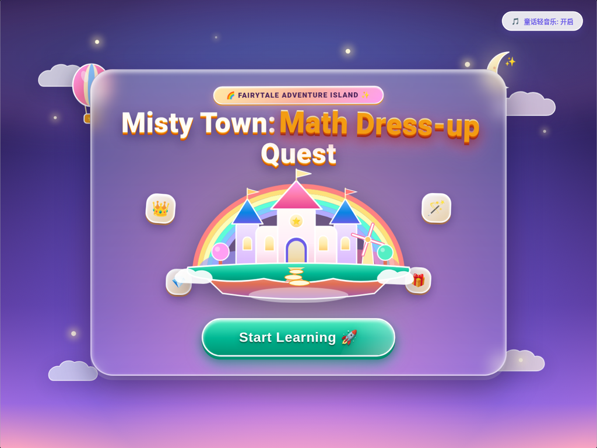
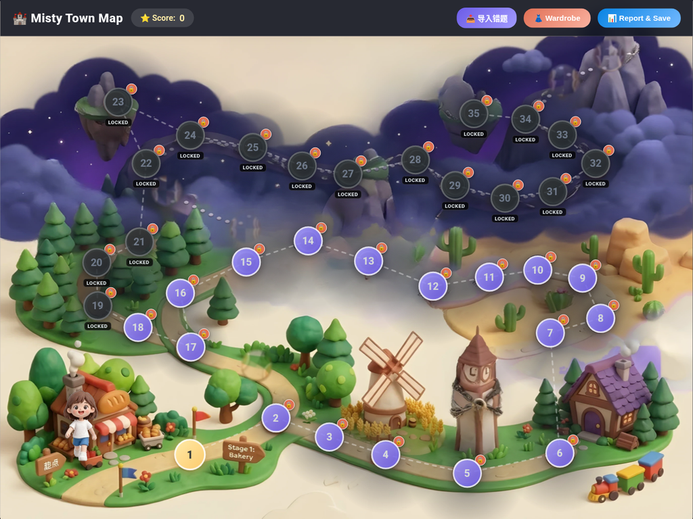

# 🏰 Misty Town: Math Dress-up Quest · 迷雾小镇数学换装闯关

[](https://github.com/TimzzZZZ666/misty-town-math-quest/actions/workflows/ci.yml)
[](LICENSE)

**▶️ 在线试玩 / Play online：<https://timzzzzz666.github.io/misty-town-math-quest/>**（无需安装，浏览器直接打开；进度只保存在你自己的浏览器里）

<p align="center">
  
  
</p>

一个面向小学一年级、**全英文题干**的数学「错题订正 + 换装闯关」网页小游戏。
孩子在地图上一关一关答题，答对攒积分，用积分在「魔法衣橱」里兑换新服装；家长可以一键导出学情报告，交给任意 AI 助手生成针对弱项的变式题，再导入游戏变成新关卡。

> 本项目是作者在学习 AI 辅助开发过程中做的作品，刚刚公开发布，由作者持续维护中。

---

## ✨ 功能

- **35 关闯关地图**：手绘风格大地图，角色会沿路径行走到关卡节点；未解锁区域被迷雾覆盖，通关上一关才开放下一关。
- **内置 4 个示例关卡**（英文题干，一年级数学）：
  1. Bakery — 基数与序数（how many vs. which position）
  2. Windmill — 一一对应，比多少（more / fewer）
  3. Clock Tower — 韦恩图与交集
  4. Cozy Cottage — 序列位置与移走卡片后的重新计数
- **多种图示题型**：`icons`、`lineup`、`pairing`、`venn_diagram`、`card_train`。
- **积分与衣橱**：答对得分、知识点掌握奖励、满星通关奖励；10 套整装皮肤（含带翅膀的分层动态皮肤）用积分兑换。
- **答错有温和提示**，通关有烟花彩带庆祝；可开关的 Web Audio 八音盒背景音乐。
- **家长区**：
  - 「Copy for AI」一键复制 Markdown 学情诊断报告（正确率、待巩固知识点、机器可读 JSON、给出题 AI 的指令）。
  - 导入题目 JSON，把新题放进第 5–35 关（前 4 关为内置题，不会被覆盖）。
  - 导出 / 导入存档 `.json`，方便换设备。
- **本地存档**：进度保存在浏览器 `localStorage`，多标签页同步，存档损坏时自动备份。
- **零依赖单文件**：所有图片已内嵌在 `index.html` 中，不需要网络、不需要安装。
- 界面主要针对 **iPad 横屏** 优化，桌面浏览器同样可用。

## 🚀 如何运行

**最快方式：** 直接打开在线版 <https://timzzzzz666.github.io/misty-town-math-quest/>。

本地运行：

1. 下载或克隆本仓库：
   ```bash
   git clone https://github.com/TimzzZZZ666/misty-town-math-quest.git
   ```
2. 用浏览器（Chrome / Safari / Edge）直接打开 `index.html` 即可。
   - iPad：可通过 AirDrop / 文件 App 把 `index.html` 放到设备上，用 Safari 打开。
   - 也可以用任意静态服务器托管，例如 `python3 -m http.server`，或开启 GitHub Pages。
3. 调试模式：在地址后加 `?debug=1`，会出现积分调试按钮，且使用独立的调试存档，不影响正式进度。

> 注意：以 `file://` 方式打开时，部分浏览器按完整文件路径隔离 `localStorage`。换了文件位置或文件名，旧进度不会自动带过去——请先在家长区导出存档，再在新位置导入。

## 📝 导入新题

在家长区点击「导入错题」，粘贴 JSON 或选择 `.json` 文件。格式示例见 [`examples/sample-stage-5.json`](examples/sample-stage-5.json)：

```json
{
  "stages": [
    {
      "id": 5,
      "title": "Stage 5: Fruit Market",
      "topicTag": "compare_more_fewer",
      "questions": [
        {
          "id": "Q5_1",
          "prompt": "There are 5 apples 🍎 and 3 pears 🍐. How many more apples than pears?",
          "visualType": "icons",
          "visualData": ["🍎", "🍎", "🍎", "🍎", "🍎", "🍐", "🍐", "🍐"],
          "options": ["2", "3", "8"],
          "correctAnswer": "2",
          "hint": "Match each pear with one apple. How many apples are left?"
        }
      ]
    }
  ]
}
```

规则：
- 关卡号只能是 5–35；
- 每题必须有 `prompt`、`options`（至少 2 个）和 `correctAnswer`，且答案必须是选项之一；
- `visualType` 可选：`icons`、`lineup`、`pairing`、`venn_diagram`（需提供 `visualData.squareOnly / overlap / circleOnly`）、`card_train`。

## 🧪 开发与检查

仓库带有 GitHub Actions CI（`.github/workflows/ci.yml`），每次推送都会运行：

- `scripts/check_repo.py`：按游戏的导入规则校验 `examples/*.json`，并对所有受跟踪文件做隐私扫描（本地绝对路径、手机号、邮箱、密钥样式字符串）。
- `scripts/smoke_test.py`：用无头 Chrome 打开 `index.html`，确认没有 JS 报错、能进入地图，并能通过游戏自身逻辑导入示例题。

本地运行：

```bash
python3 scripts/check_repo.py
pip install playwright && python3 scripts/smoke_test.py   # 需要本机已安装 Chrome，可用 CHROME_PATH 指定
```

## 🛠 技术栈

- 原生 **HTML + CSS + JavaScript**（无框架、无构建步骤、无第三方依赖）
- **Canvas** 绘制烟花与彩带动画，**SVG** 绘制开场城堡与地图路线
- **Web Audio API** 合成背景音乐与音效
- **localStorage** 本地持久化
- 美术素材为 AI 生成的黏土风插画，以 WebP Base64 内嵌

## 📌 项目状态与路线图

当前状态：**可玩的早期版本**，刚刚公开，作者在持续迭代。

计划中（可能调整）：
- [ ] 更多内置关卡与题型
- [ ] 新一批服装皮肤（已有原型设计，尚未接入游戏）
- [ ] 把单文件拆分为源码 + 构建流程，便于维护
- [ ] 更完善的移动端 / 不同屏幕尺寸适配

路线图的具体条目见 [Issues](https://github.com/TimzzZZZ666/misty-town-math-quest/issues)，欢迎提 Issue 交流建议。版本变更见 [CHANGELOG.md](CHANGELOG.md)。

## 🔒 隐私说明

游戏不联网、不收集任何数据，所有进度只保存在你自己的浏览器里。导出的存档和学情报告可能包含孩子的答题记录，请自行妥善保管，不要提交到公开仓库（`.gitignore` 已默认忽略 `math_quest_save_*.json`）。

## 📄 License

[MIT](LICENSE)

---

## English Summary

**Misty Town: Math Dress-up Quest** is a single-file, zero-dependency browser game for first-grade math practice with English-language questions. Kids clear stages on a 35-level map, earn points, and redeem outfits in a wardrobe. A parent zone exports a Markdown learning report (accuracy, weak topics, machine-readable JSON) that can be pasted into any AI assistant to generate follow-up questions, which can then be imported back into stages 5–35 as JSON. Progress is stored locally in `localStorage`; nothing is sent over the network.

**Play online:** <https://timzzzzz666.github.io/misty-town-math-quest/>

**Run locally:** open `index.html` in a modern browser (optimized for iPad landscape). Add `?debug=1` for debug mode.

**Status:** early but playable; newly published and actively maintained by the author, who built it while learning AI-assisted development. Licensed under MIT.
